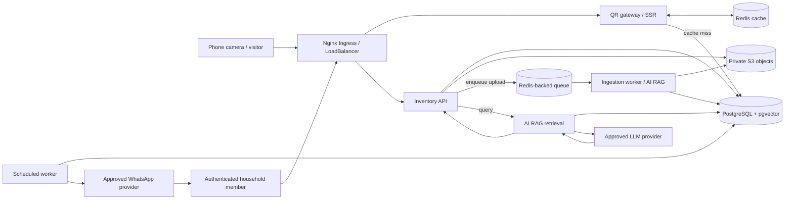
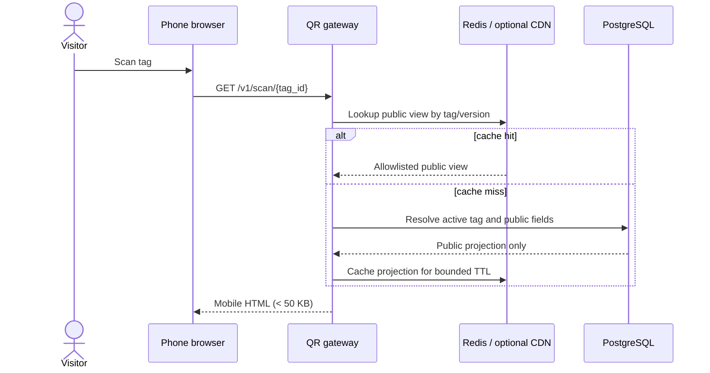
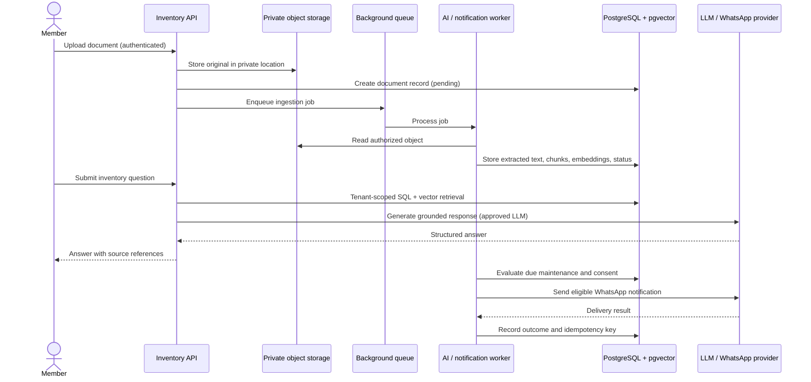

# System Architecture

## Design overview

- Use Python/FastAPI for REST APIs and server-rendered Jinja2 for public QR pages. 
- PostgreSQL with `pgvector` is the authoritative store for structured records and document embeddings.
- S3 stores original uploads; Redis supports caching and background-job coordination. A worker handles OCR/embedding work and scheduled maintenance checks.

The four named components are logical responsibility boundaries. Start as a modular application and worker unless deployment, scaling, or security requirements justify splitting them into separately deployed services.

## Component responsibilities

| Component | Responsibility | Main dependencies |
|---|---|---|
| `qr-gateway-service` | Public `GET /v1/scan/{tag_id}`, authenticated tag issue/rotation/revocation, field allowlisting, SSR Jinja2 page, cache reads/invalidation | FastAPI, templates, PostgreSQL, Redis; optional CDN (disabled) |
| `inventory-management-service` | Authentication, household membership, property/appliance/technician/service CRUD, upload coordination | FastAPI, Pydantic, PostgreSQL, S3 |
| `ai-rag-service` | Ingestion pipeline, embeddings, hybrid retrieval, grounded response generation | PostgreSQL/pgvector, OCR/LLM providers, S3 |
| `notification-cron-worker` | Due-item evaluation, scheduled notifications, delivery status/retries | PostgreSQL, Redis/worker system, WhatsApp provider |

`app/api/` contains route controllers, `app/services/` contains business logic and integrations, `app/db/` contains persistence models and migrations, and `app/templates/` contains QR SSR templates. Do not put business rules in route handlers.

## Context and data-flow diagram

## Kubernetes deployment boundaries

- **Nginx:** Nginx Ingress Controller exposed by its Kubernetes `LoadBalancer` Service; the application Ingress routes requests to the internal API Service.
- **Web/API runtime:** Two-replica Deployment serving authenticated REST endpoints and public SSR. Public QR lookups must not require user credentials.
- **Worker runtime:** To be added as a separate Deployment when background processing is implemented.
- **PostgreSQL:** One-replica StatefulSet with a PVC for local development; Service is internal to the namespace. This default is not an HA/backup plan for production.
- **Redis:** One-replica internal Deployment used for cache/queue coordination. QR cache contents are non-authoritative and disposable.
- **S3:** Future private object storage; clients access uploads through short-lived, scoped upload/download authorization rather than public object URLs.
- **CDN:** Optional edge cache for public QR pages only after cache-key, privacy, and invalidation behavior are defined.

The local deployment uses ordered `kubectl` manifests under `k8s/`. The API image is built from the root `Dockerfile`; an Alembic Job performs schema migration before API rollout. Secrets are created outside the checked-in manifests. The Nginx Ingress Controller must be installed in the cluster; Docker Desktop already provides it.

## Sequence: public scan

## Sequence: upload, retrieval, and alert

## Scalability and resilience

QR reads are read-heavy and may use bounded caching, but PostgreSQL remains the source of truth. Cache invalidation must occur when public fields, tag state, or visibility changes. Background work must be idempotent, retryable, and observable. Provider calls need explicit timeouts and error states; do not silently substitute fabricated results.
