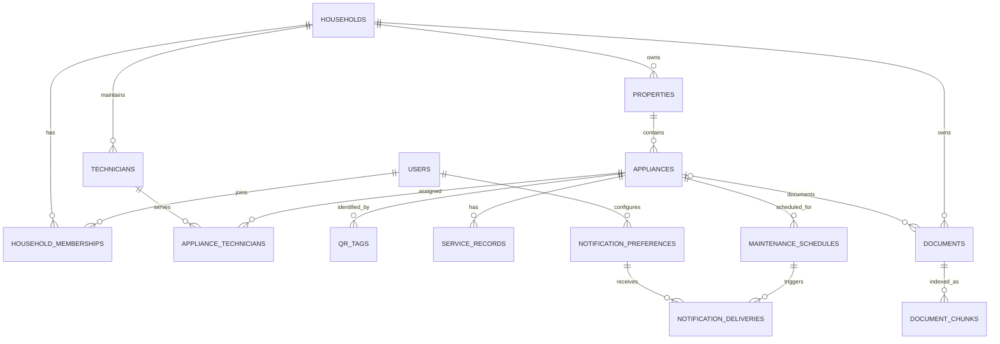

# Data Model

PostgreSQL is the source of truth for structured records and `pgvector` embeddings. Use UUID/opaque internal identifiers, UTC timestamps, foreign keys, explicit deletion/retention policies, and indexes for tenant-scoped access. Every household-owned read and write must include an authorization scope, not merely an identifier lookup.

## Core entities

| Entity | Important fields and relationships |
|---|---|
| `users` | `id`, normalized unique email, Argon2 password verifier, active status, timestamps |
| `households` | `id`, display name, timestamps; ownership is represented by an owner membership |
| `household_memberships` | `household_id`, `user_id`, role/status, membership timestamps; unique household/user pair |
| `properties` | `id`, `household_id`, name, optional address/location fields, archived state |
| `appliances` | `id`, `property_id`, name, make/model, private serial number, purchase/warranty dates, status |
| `technicians` | `id`, `household_id`, name, contact details, optional organization; private by default |
| `appliance_technicians` | appliance and technician relationship, primary flag |
| `qr_tags` | `id`, appliance reference, unique cryptographically random `tag_id`, active/revoked state, allowlisted public field names, timestamps |
| `service_records` | `id`, appliance reference, event date, description, optional technician, cost if captured, public visibility |
| `maintenance_schedules` | `id`, appliance reference, rule/type, interval or due date, enabled state, next due date |
| `documents` | `id`, household/appliance references, private object key, category, content metadata, processing state, timestamps |
| `document_chunks` | `id`, document reference, chunk index/text, embedding vector, source/page metadata |
| `notification_preferences` | household/user owner, channel, protected destination, consent and opt-out state/timestamps |
| `notification_deliveries` | schedule and recipient references, due window, idempotency key, provider reference, status, attempt/error timestamps |

The initial implementation supports owner/member roles. Both roles can manage inventory; only owners can add or deactivate members. Ownership transfer and invitation workflows remain product decisions.

## Entity relationship diagram

## Integrity, privacy, and retrieval constraints

- Verify property-to-household ownership on every appliance operation; verify appliance-to-household ownership on documents, tags, service records, and schedules.
- QR identifiers are generated with cryptographic randomness, stored uniquely, revocable, and independent of appliance database IDs. The public field allowlist is limited to appliance name, make, model, warranty expiry, technician contact, and service history.
- Public QR reads query a dedicated allowlisted projection and honor visibility/revocation state.
- Keep S3 object keys private and opaque. Persist tenant ownership and object key together; authorize every object operation through the application.
- Apply unique constraints for login identifiers, tag IDs, membership pairs, and notification idempotency keys.
- Add indexes for household/property ownership joins, active tag lookup, due maintenance date, document status, and vector search as appropriate.
- Define retention and hard-delete/cascade behavior for account, household, appliance, and document deletion before implementation.
- Store embeddings with model/dimension metadata so model changes can be migrated without mixing incompatible vectors.
